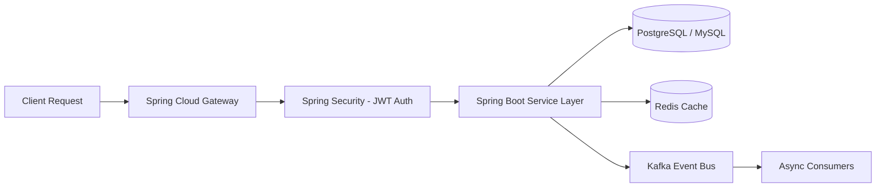

<!-- Profile Header -->
<h1 align="center">👋 Hi, I'm Venkata Rami Reddy Bobbala</h1>
<h3 align="center">🚀 Java Backend Developer | Spring Ecosystem | Microservices | Event-Driven Systems | AI Integration</h3>

  
  
  

---

### 🌩️ About Me

I'm a **Java Backend Developer with 4 years of experience** building **scalable, production-grade distributed systems** with Java and the **Spring ecosystem**.  
At **Tata Consultancy Services**, I delivered event-driven microservices with **Apache Kafka**, low-latency caching with **Redis**, and containerized deployments with **Docker**.  
I'm also building with **Spring AI**, including LLM tool-calling agents, and I focus on maintainable architecture, database performance, and secure API design with **JWT** and **RBAC**.

---

### 🧰 Tech Stack

| Category | Tools & Technologies |
|-----------|----------------------|
| 💻 **Languages** | Java (8/11/17), SQL |
| 🧩 **Frameworks** | Spring Boot, Spring MVC, Spring Data JPA, Spring JDBC, Spring Security, Spring AOP, Spring AI |
| ⚙️ **Architecture** | Microservices, REST APIs, Event-Driven Architecture, Spring Cloud Gateway, gRPC |
| ⚡ **Messaging & Caching** | Apache Kafka, Redis, Spring Cache, Lettuce |
| 🗄️ **Databases** | PostgreSQL, MySQL, Indexing, Query Optimization |
| 🔐 **Security** | Spring Security, JWT, Role-Based Authorization |
| 🐳 **DevOps & Tooling** | Docker, Docker Compose, Git, Maven, CI/CD Pipelines |
| 🧪 **Testing** | JUnit, Mockito, Testcontainers, Integration Testing |

---

### 💼 Professional Experience

**Java Backend Developer @ Tata Consultancy Services (TCS)**, Hyderabad, India · Dec 2021 – Dec 2025

- Built and maintained scalable backend microservices with Java 17, Spring Boot, and Spring MVC, supporting 10,000+ concurrent users at 99.9% uptime.
- Designed Kafka event-driven pipelines for asynchronous inter-service communication, reducing service coupling and improving throughput by 40% under peak load.
- Implemented Redis distributed caching with Spring Cache and Lettuce, cutting average API response times by 60% on high-frequency reads.
- Containerized microservices with Docker, standardizing dev/prod environments and reducing deployment setup time by 30%.
- Improved PostgreSQL and MySQL performance through indexing and query refactoring, reducing slow query count by 35%.
- Engineered JWT-based authentication and role-based authorization with Spring Security across production services.
- Led production incident investigations using log analysis and profiling, delivering hotfixes with sub-2-hour MTTR.

---

### 🚀 Projects

**AI Agents: Tool-Calling Agent Platform** · `Spring AI` `Spring Boot` `OpenAI` `Lombok`  
[GitHub](https://github.com/venkataramireddy1999)

- Built a conversational agent where the LLM selects and invokes the correct backend tool at runtime, replacing hardcoded if/else routing.
- Implemented five `@Tool`-annotated tool sets across travel (flights, hotels, weather) and e-commerce support (orders, inventory), exposed through a single REST `/chat` endpoint.
- Added sliding-window `ChatMemory` to keep context across multi-turn conversations.

**Patient Management System: Microservices Platform** · `Java 17` `Spring Boot` `Kafka` `gRPC` `Docker`  
[GitHub](https://github.com/venkataramireddy1999)

- Designed five independently deployable services (API Gateway, Auth, Patient, Billing, Analytics) on an internal Docker network.
- Implemented JWT authentication and centralized routing with Spring Cloud Gateway, keeping downstream services internal-only.
- Used gRPC for synchronous Patient-to-Billing calls and Kafka for asynchronous event streaming to the Analytics service, with isolated PostgreSQL databases per service.

---

### 🏗️ Backend Workflow Overview

---

### 🎓 Education

**Bachelor of Technology (B.Tech)**, Electrical and Electronics Engineering · ACE Engineering College, Hyderabad (2017 – 2021)

---

### 📫 Let's Connect

I'm open to Java backend and Spring-focused roles. Reach me at [venkataramireddy1999@gmail.com](mailto:venkataramireddy1999@gmail.com) or on [LinkedIn](https://www.linkedin.com/in/venkataramireddy-bobbala/).
